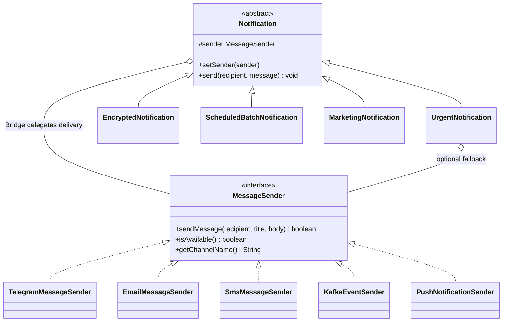

# Multi-Channel Notification Gateway

Java 17+ implementation of the Bridge pattern for Assignment 3. All deliveries are simulated and printed to the console; no external Telegram, mail, SMS, Kafka, or push service is contacted.

## Run

With Java 17+ installed, use the included Maven Wrapper. On Windows:

```powershell
.\mvnw.cmd test
.\mvnw.cmd exec:java
```

On macOS or Linux:

```bash
./mvnw test
./mvnw exec:java
```

The demo runs all six required scenarios and also shows Kafka. Test reports are written under `target/surefire-reports`.

## UML class diagram



`Notification` is the **Abstraction**. Its subclasses are **Refined Abstractions**. `MessageSender` is the **Implementor**. The five sender classes are **Concrete Implementors**. The `Notification` → `MessageSender` reference is the Bridge.

## Design answers

- **Two independent dimensions:** what a notification does (urgent, encoded, batch, marketing) and how it is delivered (Telegram, Email, SMS, Kafka, Push).
- **Where is the Bridge?** `Notification` stores a `MessageSender` interface reference and delegates delivery through it. `setSender` changes that implementation on the same object at runtime.
- **Why is inheritance alone problematic?** A class for every combination grows as notification types × providers. With 4 types and 5 providers, that would mean up to 20 combination classes; the Bridge uses 4 notification classes and 5 sender classes instead.
- **What happens when a provider is added?** Implement `MessageSender`; existing notification classes need no edits. `PushNotificationSender` demonstrates this.
- **What happens when a notification type is added?** Extend `Notification`; existing senders need no edits. `MarketingNotification` demonstrates this.
- **Why Bridge rather than Adapter?** Bridge deliberately separates two dimensions of this design so both can vary independently. Adapter would wrap an incompatible existing API to make it fit another interface.

## Behavior notes

- Telegram simulates formatted Markdown text. Email preserves a title and appends a signature. SMS has no separate title and rejects a body longer than 160 Unicode characters. Kafka writes a simulated event. Push writes a simulated push payload.
- An urgent notification tries the primary sender first. If it is unavailable or rejects delivery, it tries the optional fallback through the same `MessageSender` interface; it never checks the concrete sender type.
- `EncryptedNotification` uses Base64 as the assignment permits. Base64 is encoding, **not secure encryption**.
- `ScheduledBatchNotification` holds recipients and sends when `send` is called. The inherited `recipient` argument may add one more unique recipient; pass `null` to send only to the stored list. It records `Total`, `Successful`, and `Failed`. Delayed scheduling was not requested.

## Individual defense quick checks

- Add WhatsApp: make a new class implementing `MessageSender`; use it with any `Notification`.
- Change the SMS limit: edit `SmsMessageSender.MAX_CHARACTERS` and update the boundary tests.
- Add a notification type: extend `Notification` and call `sender.sendMessage(...)`.
- Make Email unavailable: call `email.setAvailable(false)` and configure an `UrgentNotification` fallback.
- Switch at runtime: call `notification.setSender(otherSender)` on the same object.
